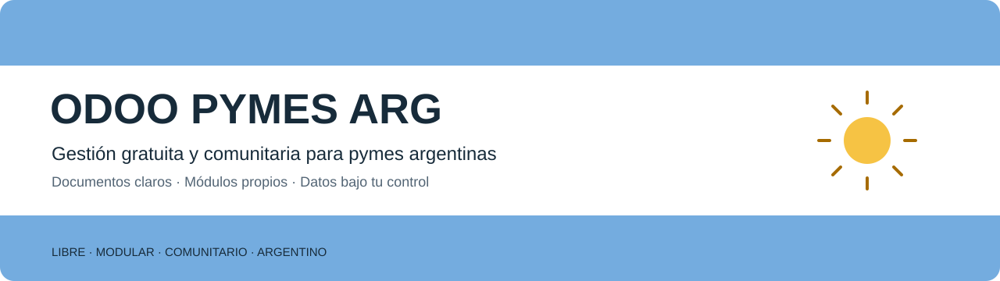
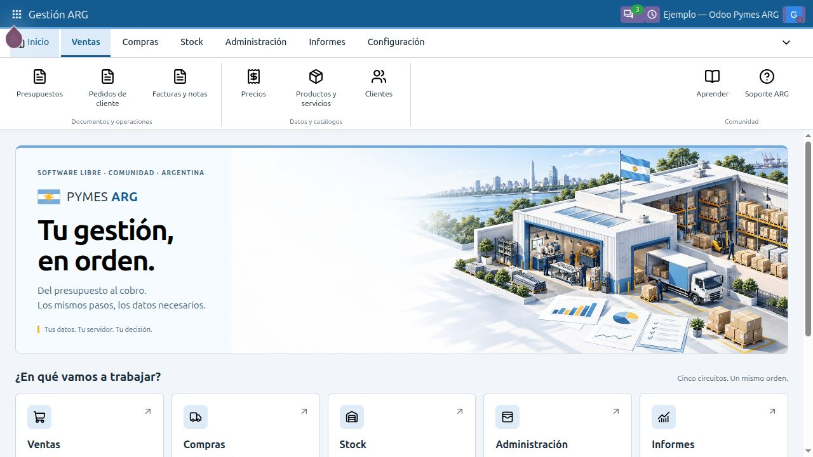

# ODOO PYMES ARG

**Gestión gratuita y comunitaria para pymes argentinas. Datos bajo tu control.**

Un proyecto modular sobre Odoo Community, con gestión documental simple e identidad argentina.
Desarrollado módulo por módulo, con documentación pública y personalización por extensiones.

Nace para compartir experiencia en tecnología y gestión empresarial con todas las pymes posibles,
aprender de sus usuarios y construir conocimiento en comunidad.
Cada negocio podrá elegir dónde alojar sus sistemas y conservar el control de sus datos.

[Por qué nace el proyecto](docs/MANIFIESTO.md)

## Quién impulsa el proyecto

Soy **Gonzalo Sarubilo**, con **más de 20 años de experiencia en tecnología para pymes**.
Pongo a disposición de la comunidad conocimientos que apliqué en mis propios negocios:
gestión financiera, dirección de empresas, redes, software y desarrollo, gestión, marketing y ventas.
Quiero compartir esa experiencia, visibilizar mi aporte y seguir aprendiendo con nuevos usuarios.

[Mi experiencia y aporte](docs/GONZALO-SARUBILO.md)

[Conocé el plan](docs/PLAN-MAESTRO.md) · [Revisá la especificación](specs/001-pyme-argentina/spec.md)
· [Explorá los módulos](docs/CATALOGO-MODULOS.md) · [Identidad visual](docs/DISENO-VISUAL.md)
· [ARG y YouTube](docs/ALCANCE-YOUTUBE.md)

> **Estado: desarrollo en curso.** Los cinco circuitos básicos, maestros e interfaz ARG están desarrollados e instalados técnicamente en el entorno de ejemplo.
> Revisión parcial de Ventas e interfaz realizada con ejemplos; aceptación y QA de los demás circuitos pendientes. Integraciones y rubros corresponden a etapas posteriores.

[Qué cambió en 0.1.3-dev](docs/entregas/INTERFAZ-Y-VENTAS.md) · [Recursos gráficos y licencias](docs/RECURSOS-VISUALES.md)

   

[Portada del proyecto](docs/site/README.md) · [Mapa de documentación](docs/INDICE.md) · [Roadmap](docs/site/ROADMAP.md) · [Cómo contribuir](CONTRIBUTING.md)

## Una base simple para gestionar

| Circuito | Gestión documental |
| --- | --- |
| Ventas | Presupuestos, pedidos, remitos, facturas y notas vinculadas |
| Compras | Pedidos a proveedor, entradas, facturas recibidas y devoluciones |
| Stock | Movimientos, depósitos, transferencias, inventarios y ajustes |
| Administración | Recibos, cobros, pagos, caja, bancos y cuenta corriente |
| Informes | Medidas claras y resultados vinculados a documentos fuente |

Primero los cinco circuitos generales. Después, integraciones y módulos por rubro.
Todos los servicios externos se agruparán en un único módulo Integraciones ARG.

## Principios

- **Gratuito y comunitario:** funciones propias abiertas, sin cuotas propias por usuario o documento.
- **Soberanía:** instalación propia, datos exportables y respaldos recuperables.
- **Carga mínima:** completar datos conocidos y pedir solamente lo necesario.
- **Orden constante:** tercero, datos generales, detalle, totales y acciones.
- **Documentos reconocibles:** códigos cortos como `PRE-000001`, `PED-000001` y `REC-000001`.
- **Modularidad:** incorporar capacidades según las necesidades de cada pyme.
- **Documentación:** aprender, instalar, mantener y contribuir mediante guías públicas.
- **Autonomía:** elegir homelab, servidor propio o VPS y personalizar con personas o agentes de IA.

Tomamos la separación documental de FactuSOL como referencia de uso.
Construimos una experiencia propia extensible sobre Odoo Community.
Usamos ARG como identidad del producto y de sus módulos.

## Documentación y desarrollo

Usamos Spec Kit para definir cada módulo antes de programarlo.

[Constitución](.specify/memory/constitution.md) · [Plan técnico](specs/001-pyme-argentina/plan.md)
· [Tareas](specs/001-pyme-argentina/tasks.md) · [Hechos y dimensiones](specs/001-pyme-argentina/data-model.md)
· [Contrato documental](specs/001-pyme-argentina/contracts/documentos.md)

Base técnica: Odoo 20 Community. [Versiones y entorno de ejemplo](docs/tecnica/ENTORNO-DEMO.md).
Presupuesto PRE y pedido PED son documentos distintos, vinculados por cabecera y línea.
La factura interna y la autorización fiscal son estados distintos; ARCA corresponde a una integración posterior.

## Comunidad

Las primeras contribuciones pueden describir recorridos de gestión, necesidades de pymes y mejoras documentales.
Usá ejemplos ficticios e identificados; evitá compartir datos de clientes, certificados o credenciales.
La guía de contribución y el [contacto privado para reportes de seguridad](SECURITY.md) están disponibles.

Usaremos YouTube para demostrar cada circuito, enseñar instalación y compartir mejoras.
Cada tutorial enlazará su versión, guía y ejemplos. El [canal Goxtech Argentina](https://www.youtube.com/@Goxtech_Arg) ya está definido; los videos específicos ARG están pendientes.
Cada módulo tendrá sus tutoriales vinculados desde la ayuda, con estado y versión compatibles.
El soporte general ARG será administrado por el responsable mediante correo, WhatsApp o tickets configurables.
GOXTECHBOT aportará el branding suave del bot dentro de la identidad general ARG.

[Ayuda, tutoriales y soporte](docs/AYUDA-TUTORIALES-SOPORTE.md) · [Web, WhatsApp y contacto](docs/comunidad/CONTACTO.md)

El software del proyecto será gratuito. Alojamiento, proveedores externos y asistencia podrán tener costos opcionales.
Código original: **AGPL-3.0**. Documentación y recursos originales: **CC BY-SA 4.0**.
[Licencias y atribuciones](NOTICE.md); Odoo y terceros conservan sus licencias.

Gonzalo Sarubilo también ofrece consultoría y servicios para pymes, como actividad profesional secundaria
al propósito comunitario de ARG. Aprender, participar y utilizar el proyecto no requiere contratar esos servicios.

Proyecto comunitario impulsado por Gonzalo Sarubilo · GoxtechLabs. Odoo y FactuSOL son referencias de sus respectivos titulares.
