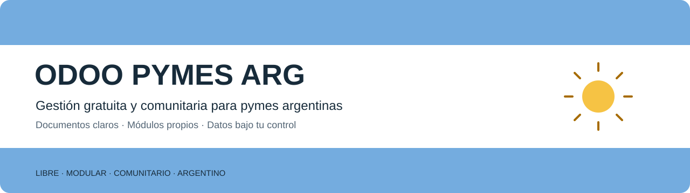

# Gestión simple. Conocimiento compartido.

Una gestión gratuita y comunitaria para micropymes y pymes argentinas, sobre Odoo Community.
Podés alojarla en tu homelab, servidor o VPS y personalizarla con personas o agentes de IA.
La gestión local no necesita una cuenta Goxtech ni una suscripción de IA.

   

**Estado:** cinco circuitos básicos y doce addons propios instalados técnicamente en una demo.
QA funcional/visual y aceptación pendientes. No se anuncian integraciones, homologación fiscal ni rubros como entregados.
La primera publicación se prepara con código, documentación y licencias; su estado se identifica en cada entrega.

## Cinco circuitos, documentos claros

| Circuito | Para qué sirve | Aprender |
| --- | --- | --- |
| Ventas | PRE y PED separados; entregas, facturas y notas vinculadas | [Ventas](../usuario/006-ventas.md) |
| Compras | Pedido, recepción, factura y devolución independientes | [Compras](../usuario/007-compras.md) |
| Stock | Existencias, movimientos, inventarios y ajustes | [Stock](../usuario/008-stock.md) |
| Administración | Deuda, recibos, pagos, anticipos, aplicaciones y caja | [Administración](../usuario/009-administracion.md) |
| Informes | Cada cifra con hecho, fecha, unidad, moneda y origen | [Informes](../usuario/010-informes.md) |

Siempre fecha → tercero → documento → detalle → totales → acciones. Los datos conocidos se proponen una vez;
los campos avanzados aparecen cuando hacen falta. Guardar no equivale a confirmar ni a mover dinero.
Cada documento conserva su identidad corta y sus pendientes separados: confirmar, entregar/recibir,
facturar y cobrar/pagar, con avance parcial y cantidad o importe pendiente.

[Ver un ejemplo de estados](../usuario/ESTADOS-DOCUMENTALES.md) · [Conocer el propósito](../MANIFIESTO.md)

## Aprender y aportar

Los manuales están disponibles aunque todavía no exista video. Cada módulo tiene una ficha editorial
por versión y tarea; los enlaces de YouTube se habilitan cuando existe contenido real y revisado.
Ayuda ARG y soporte general permanecen configurables por el responsable de cada instalación.

[Manuales por módulo](MANUALES.md) · [Tutoriales](tutoriales/README.md) · [Roadmap](ROADMAP.md)
· [Proponer una mejora](comunidad/PROPUESTA.md) · [Contribuir](CONTRIBUTING.md)

## Quién impulsa ARG

**Gonzalo Sarubilo**, con más de 20 años de experiencia declarada en tecnología para pymes.
Comparte lo que aplica en sus negocios: gestión financiera, dirección, redes, software, desarrollo,
gestión, marketing y ventas. La comunidad aporta casos nuevos y conocimiento que vuelve al proyecto.
Consultoría y servicios profesionales son opcionales y secundarios al propósito de compartir.

[Mi experiencia y aporte](../GONZALO-SARUBILO.md) · [Licencias y atribuciones](../../NOTICE.md)

Proyecto comunitario impulsado por Gonzalo Sarubilo · GoxtechLabs. Marca principal ARG y marca de cada pyme en sus documentos.
